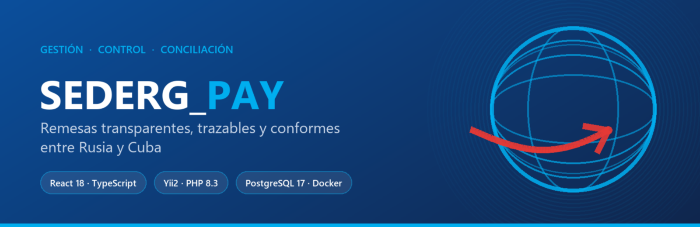
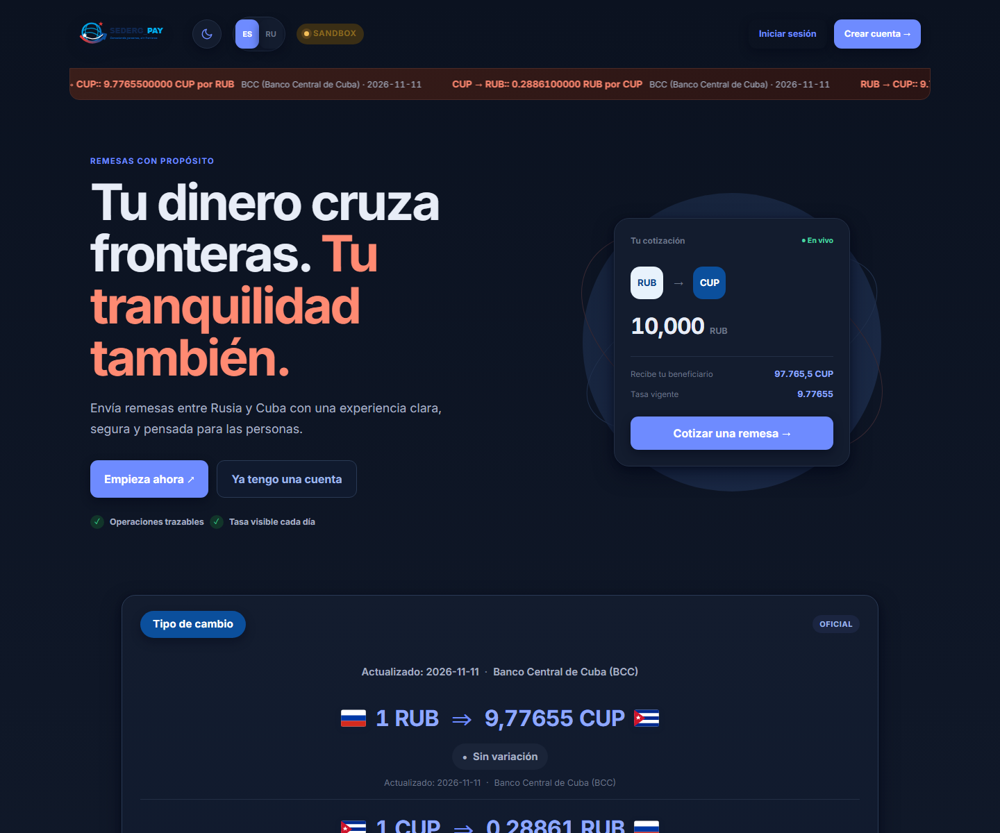
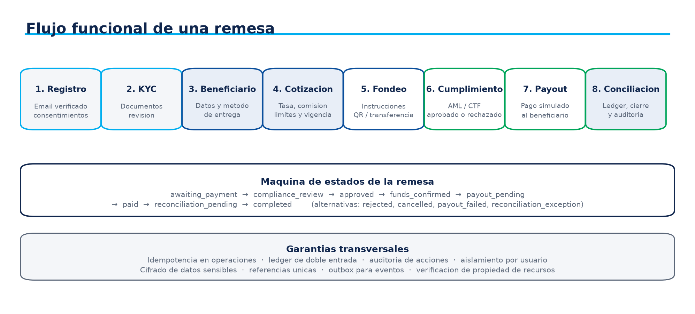
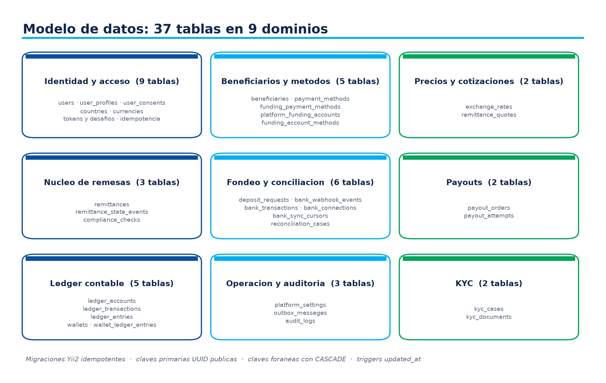
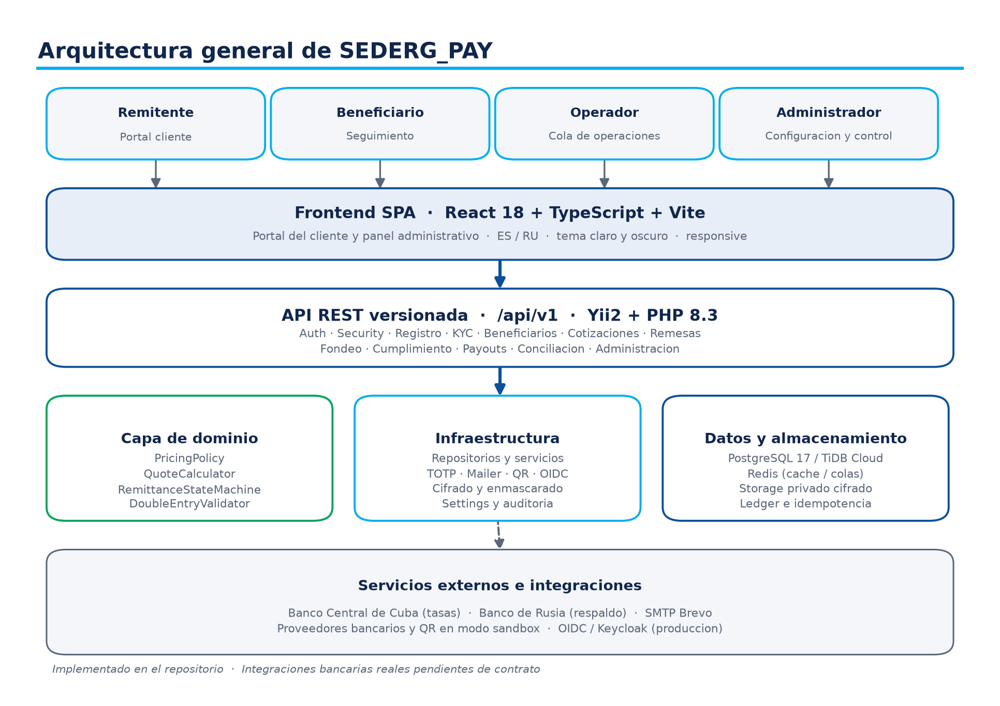

<div align="center">
  
</div>

<div align="center">

# SEDERG_PAY

**Plataforma de gestión, control y conciliación de remesas entre Rusia y Cuba**

[Demo en vivo](https://sedergsoft.github.io/SedergPay_oficial/) · [API desplegada](https://5-22-219-30.sslip.io/health) · [Documentación de despliegue](./deploy/UPCLOUD.md)

[Español](./README.md) · [Русский](./README.ru.md)

</div>

---

<div align="center">

[](https://github.com/sedergsoft/SedergPay_oficial/actions/workflows/ci.yml)
[](https://github.com/sedergsoft/SedergPay_oficial/actions/workflows/deploy-pages.yml)
[](https://github.com/sedergsoft/SedergPay_oficial/actions/workflows/deploy.yml)

[](https://react.dev/)
[](https://www.typescriptlang.org/)
[](https://www.php.net/)
[](https://www.yiiframework.com/)
[](https://www.postgresql.org/)
[](https://docs.docker.com/)
[](https://caddyserver.com/)

</div>

<div align="center">

🌍 **App en vivo:** <https://sedergsoft.github.io/SedergPay_oficial/>
🔌 **API pública:** <https://5-22-219-30.sslip.io>
🩺 **Health check:** <https://5-22-219-30.sslip.io/health>
🇷🇺🇨🇺 **Idiomas:** Español · Русский

</div>

---

## 📸 Capturas

<div align="center">
  
</div>

<div align="center">
  <table>
    <tr>
      <td width="50%"></td>
      <td width="50%"></td>
    </tr>
    <tr>
      <td align="center">Ciclo completo de una remesa</td>
      <td align="center">Modelo físico de datos</td>
    </tr>
  </table>
</div>

---

## 📖 Índice

- [¿Qué es SEDERG_PAY?](#-qué-es-sederg_pay)
- [Módulos funcionales](#-módulos-funcionales)
- [Stack tecnológico](#-stack-tecnológico)
- [Arquitectura](#-arquitectura)
- [Arranque rápido](#-arranque-rápido)
- [Despliegue en producción](#-despliegue-en-producción)
- [API REST](#-api-rest)
- [Seguridad](#-seguridad)
- [Idiomas](#-idiomas)
- [Calidad y CI](#-calidad-y-ci)
- [Estructura del repositorio](#-estructura-del-repositorio)
- [Documentación](#-documentación)
- [Hoja de ruta](#-hoja-de-ruta)
- [Contribuir](#-contribuir)
- [Licencia](#-licencia)

---

## 💡 ¿Qué es SEDERG_PAY?

SEDERG_PAY es una plataforma de **remesas** que centraliza la cotización, el envío, el
cumplimiento, la conciliación y la trazabilidad de las transferencias entre Rusia y Cuba.

El producto combina tres piezas:

| Pieza | Tecnología | Papel |
|---|---|---|
| **Portal web** | React 18 + TypeScript + Vite | Cotización en vivo, alta de beneficiarios, seguimiento y panel administrativo |
| **API REST** | Yii2 + PHP 8.3 | Reglas de negocio, idempotencia, KYC, seguridad de cuenta y auditoría |
| **Datos** | PostgreSQL 17 | Esquema transaccional, ledger, idempotencia y registro de auditoría |

### ✅ Implementado

- Cotizaciones con **tasa oficial del Banco Central de Cuba** y tasa administrativa por par.
- Registro con verificación de correo, consentimiento versionado y perfil de usuario.
- **MFA (TOTP)** con códigos de recuperación, cambio y recuperación de contraseña.
- Altas y gestión de **beneficiarios** con métodos de pago por país.
- Ciclo de remesas: cotización → orden → depósito → cumplimiento → conciliación.
- **KYC** con validación de firma real de archivo y **escaneo antimalware con ClamAV** (*fail-closed*).
- Panel de administración: ajustes operativos, tasas, usuarios, KYC, métricas e historial.
- Ledger con **doble partida**, idempotencia por clave y auditoría de acciones críticas.
- Despliegue automatizado: GitHub Pages (frontend) + UpCloud (API, PostgreSQL, ClamAV, Caddy con TLS).

### ⚠️ Límites honestos del estado actual

- Las **integraciones bancarias son simuladas** (modo *sandbox*): no hay custodia de fondos ni
  acceso a cuentas reales. Requieren contrato y credenciales del proveedor.
- El despliegue público usa `SEDERG_AUTH_MODE=development`, pensado **solo para demostración**.
  Para operar con clientes reales hay que activar OIDC/Keycloak, SMTP y KYC obligatorio.
- El ledger es una base inicial: debe evolucionar a doble partida explícita antes del piloto.
- La documentación contractual y regulatoria se valida externamente.

---

## 🧩 Módulos funcionales

| Módulo | Qué hace | Estado |
|---|---|---|
| **Cotizaciones** | Calcula importe recibido, comisión y límites; conserva vigencia de 15 min | ✅ Implementado |
| **Remesas** | Maquina de estados: creada → depositada → en cumplimiento → pagada/reconciliada | ✅ Implementado |
| **Depósitos** | Solicitud de fondeo con referencia, QR y cuenta de funding | ✅ Sandbox |
| **Payouts** | Colas de pago por proveedor y método | ✅ Sandbox |
| **Conciliación** | Emparejamiento de depósitos con transacciones bancarias y casos de revisión | ✅ Sandbox |
| **Cumplimiento** | Checks por remesa, revisión manual y motivos de rechazo | ✅ Implementado |
| **KYC** | Casos, documentos cifrados, escaneo ClamAV y decisión del revisor | ✅ Implementado |
| **Seguridad de cuenta** | 2FA, cambio y recuperación de contraseña, desafíos de autenticación | ✅ Implementado |
| **Administración** | Ajustes operativos, tasas por par, usuarios, panel e historial | ✅ Implementado |
| **Bancos reales** | Conexiones bancarias y webhooks del proveedor | ⏳ Pendiente de contrato |

---

## 🛠️ Stack tecnológico

### Backend

| Tecnología | Versión | Uso |
|---|---|---|
| PHP | 8.3 | Runtime del API |
| Yii2 | 2.0.55 | Framework MVC, migraciones y validación |
| PostgreSQL | 17 | Persistencia, triggers y restricciones |
| PHPUnit | 10.5 | Pruebas unitarias y de integración |
| ClamAV | stable | Escaneo antimalware de adjuntos KYC |

### Frontend

| Tecnología | Versión | Uso |
|---|---|---|
| React | 18.3 | SPA del cliente y panel administrativo |
| TypeScript | 5.6 | Tipado estricto del dominio |
| Vite | 5.4 | Empaquetado y build de producción |
| Nginx | 1.27 | Serve estático y proxy `/api` |

### Infraestructura

| Tecnología | Uso |
|---|---|
| Docker Compose | Stack completo (API, PostgreSQL, ClamAV, Caddy, frontend) |
| Caddy 2 | TLS automático (ZeroSSL/Let's Encrypt) y reverse proxy |
| UpCloud | Cloud Server para el backend |
| GitHub Actions | CI, publicación en Pages y despliegue por SSH al servidor |

---

## 🏗️ Arquitectura

<div align="center">
  
</div>

El dominio está aislado de la infraestructura: `PricingPolicy`, `QuoteCalculator`,
`RemittanceStateMachine` y `DoubleEntryValidator` no dependen del framework. Los adaptadores
(TOTP, correo, QR, OIDC, cifrado) se inyectan, de modo que sustituir un proveedor no toca las
reglas de negocio.

---

## 🚀 Arranque rápido

### Opción 1 — Stack local autocontenido (recomendado)

```bash
git clone https://github.com/sedergsoft/SedergPay_oficial.git
cd SedergPay_oficial

# 1. Variables del stack local
cp deploy/local/env.local.example .env.local
#   o reutiliza el .env de desarrollo:  --env-file .env

# 2. Construir y arrancar
docker compose --env-file .env.local -f deploy/local/docker-compose.local.yml up -d --build

# 3. Aplicar el esquema (16 migraciones)
docker compose --env-file .env.local -f deploy/local/docker-compose.local.yml \
  run --rm backend php yii migrate --interactive=0
```

| Servicio | URL local |
|---|---|
| Frontend | <http://localhost:5173> |
| API | <http://localhost:8080> |
| Health | <http://localhost:8080/health> |

> El stack local no publica PostgreSQL en el host: se accede con
> `docker compose ... exec postgres psql -U sederg_app -d sederg_pay`.
> Los correos no se envían (`SEDERG_MAIL_TRANSPORT=log`): el enlace de verificación
> queda en el log del backend.

### Opción 2 — Stack de desarrollo (con ClamAV y bind mounts)

```bash
docker compose up -d --build
docker compose run --rm backend php yii migrate --interactive=0
```

### Opción 3 — Solo el backend en PHP local

```bash
cd backend
composer install
php yii serve 0.0.0.0:8080 --docroot=web
```

---

## ☁️ Despliegue en producción

El backend está desplegado y verificado en UpCloud con TLS automático:

```bash
curl https://5-22-219-30.sslip.io/health
# {"status":"ok","service":"sederg-pay-api","environment":"sandbox"}
```

El runbook completo —servidor, firewall, DNS, secretos, despliegue, backups, rollback y
checklist de aceptación— está en **[`deploy/UPCLOUD.md`](./deploy/UPCLOUD.md)**.

### Automatización con GitHub Actions

| Workflow | Qué hace |
|---|---|
| [`ci.yml`](./.github/workflows/ci.yml) | Lint de PHP, PHPUnit, migraciones en PostgreSQL 17, validación de Compose y build del frontend |
| [`deploy-pages.yml`](./.github/workflows/deploy-pages.yml) | Publica la SPA en GitHub Pages con `VITE_API_BASE_URL` apuntando a la API |
| [`deploy.yml`](./.github/workflows/deploy.yml) | Despliega el backend en UpCloud por SSH: `rsync` incremental, migraciones, espera de salud y **rollback automático** |
| [`migrate-db.yml`](./.github/workflows/migrate-db.yml) | Aplica migraciones contra la base de datos gestionada |

El despliegue remoto es idempotente y se puede lanzar a mano desde *Actions →
Deploy backend to UpCloud* con opciones de reconstrucción completa o salto de migraciones.

---

## 🔌 API REST

Contrato versionado en [`backend/docs/openapi.yaml`](./backend/docs/openapi.yaml) · 17 rutas en `/api/v1`.

| Método | Ruta | Descripción |
|---|---|---|
| `GET` | `/health` | Sonda de estado del servicio |
| `POST` | `/api/v1/registrations` | Alta de cliente con consentimiento versionado |
| `POST` | `/api/v1/auth/login` | Autenticación (OIDC en producción) |
| `POST` | `/api/v1/auth/verify-email` | Verificación del correo |
| `GET` | `/api/v1/account/security` | Estado de 2FA y sesión |
| `POST` | `/api/v1/account/security/2fa/setup` | Alta de TOTP |
| `GET` | `/api/v1/funding-methods/{country}` | Métodos de pago por país |
| `POST` | `/api/v1/beneficiaries` | Alta de beneficiario |
| `POST` | `/api/v1/quotes` | Cotización con tasa vigente y comisión |
| `POST` | `/api/v1/remittances` | Creación de remesa a partir de una cotización |
| `POST` | `/api/v1/remittances/{id}/deposit` | Solicitud de depósito |
| `POST` | `/api/v1/remittances/{id}/compliance-review` | Revisión de cumplimiento |
| `POST` | `/api/v1/remittances/{id}/reconcile` | Conciliación del pago |
| `GET/PUT` | `/api/v1/admin/settings` | Ajustes operativos (comisión, límites, vigencia) |
| `POST` | `/api/v1/admin/exchange-rate` | Tasa administrativa por par |

### Ejemplo

```bash
curl -X POST https://5-22-219-30.sslip.io/api/v1/quotes \
  -H 'Content-Type: application/json' \
  -H 'Idempotency-Key: 3f1c0b7e-4f2a-4a1e-9c33-9f0d1a2b3c4d' \
  -d '{
        "source_country_code": "RU",
        "destination_country_code": "CU",
        "send_amount": "20000",
        "send_currency": "RUB",
        "receive_currency": "CUP",
        "payout_method_code": "cash_pickup"
      }'
```

```json
{
  "receive_amount": "195531.00",
  "exchange_rate": "9.7765500000",
  "exchange_rate_source": "BCC (Banco Central de Cuba)",
  "fee_amount": "600.00",
  "fee_currency": "RUB",
  "total_debit_amount": "20600.00",
  "status": "valid"
}
```

---

## 🔐 Seguridad

| Control | Implementación |
|---|---|
| Autenticación | OIDC/Keycloak en producción · modo `development` con cabecera de identidad en sandbox |
| MFA | TOTP con códigos de recuperación y desafíos de autenticación |
| Datos sensibles | Cifrado de adjuntos KYC y de datos de cuenta con claves fuera del repositorio |
| Antimalware | ClamAV en red interna; si no está disponible, la carga **se rechaza** (*fail-closed*) |
| Idempotencia | Obligatoria en cotizaciones y remesas; reintentos sin duplicados |
| Auditoría | Registro de acciones críticas con actor y correlación |
| Ledger | Partida doble y saldos verificables |
| Red | PostgreSQL, ClamAV y la API **no** se publican a Internet; solo 80/443 |
| secretos | Solo en variables de entorno (`chmod 600`) y en GitHub Secrets cifrados |

---

## 🌍 Idiomas

La interfaz pública y la navegación están disponibles en **español** y **ruso** mediante el
catálogo centralizado de [`frontend/src/i18n.ts`](./frontend/src/i18n.ts). La preferencia se
guarda localmente y el diseño es *mobile-first*, con tema claro y oscuro.

---

## 🧪 Calidad y CI

| Elemento | Cantidad |
|---|---|
| Migraciones PostgreSQL | 16 |
| Clases de dominio | 29 |
| Ficheros de prueba | 9 |
| Rutas REST documentadas | 17 |
| Workflows de CI/CD | 4 |

Cada `push` a `main` dispara el lint de PHP, la suite de PHPUnit, las migraciones sobre
PostgreSQL 17, la validación de los tres ficheros de Compose y la compilación de TypeScript.

---

## 📂 Estructura del repositorio

```text
SEDERG_PAY/
├── backend/            API Yii2: dominio, controladores, migraciones y OpenAPI
│   ├── src/            Reglas de negocio e infraestructura (29 clases)
│   ├── migrations/     16 migraciones PostgreSQL
│   ├── tests/          Pruebas unitarias y de integración
│   └── docs/           openapi.yaml
├── frontend/           SPA React + TypeScript (i18n ES/RU, panel admin)
├── deploy/             Runbook de UpCloud, scripts y stack local con copias de Composer
├── docs/               Diagramas y generadores de la memoria técnica
├── scripts/            Utilidades de migración MySQL → PostgreSQL
├── docker-compose.yml              Stack de desarrollo
├── docker-compose.production.yml    Overlays de producción (Caddy, ClamAV, sin puertos internos)
└── PLAN_DE_ACCION.md   Hoja de ruta con fases, entregables y gates
```

---

## 📚 Documentación

| Documento | Contenido |
|---|---|
| [`PLAN_DE_ACCION.md`](./PLAN_DE_ACCION.md) | Fases F0–F6, entregables, gates y riesgos bloqueantes |
| [`deploy/UPCLOUD.md`](./deploy/UPCLOUD.md) | Runbook de despliegue, operación, backups y rollback |
| [`backend/docs/openapi.yaml`](./backend/docs/openapi.yaml) | Contrato REST versionado |
| [`PLAN_DESPLIEGUE_GRATUITO.md`](./PLAN_DESPLIEGUE_GRATUITO.md) | Plan de publicación con coste mínimo |
| `SEDERG_PAY_Presentacion_Comercial.docx` | Presentación comercial (ES) |
| `SEDERG_PAY_Memoria_Tecnica.docx` | Memoria técnica con diagramas |

---

## 🗺️ Hoja de ruta

| Fase | Estado |
|---|---|
| **F0–F1** Base controlada (modelo físico, esquema, convenciones) | ✅ |
| **F2** Contrato funcional y OpenAPI | ✅ |
| **F3** Núcleo transaccional (cotización, remesas, idempotencia) | ✅ |
| **F4** Depósito, ledger y conciliación simulados | ✅ |
| **F5** Frontend operativo en sandbox | ✅ |
| **F6** Piloto controlado (OIDC, SMTP real, ClamAV obligatorio, banco real) | ⏳ Gates externos |

---

## 🤝 Contribuir

1. Crea una rama desde `main`: `git checkout -b feature/mi-cambio`.
2. Mantén el estilo del código circundante y el dominio libre de dependencias de framework.
3. Ejecuta `docker compose --env-file .env -f deploy/local/docker-compose.local.yml run --rm backend vendor/bin/phpunit`
   y `npm run build` en `frontend/`.
4. Abre un *pull request* describiendo el cambio y su impacto en el contrato REST.

Las nuevas migraciones deben ser reversibles y ejecutarse sobre PostgreSQL 17.

---

## 📄 Licencia

**Propietaria.** Todos los derechos reservados por SEDERG. El código, la documentación y los
artefactos visuales de este repositorio no se distribuyen bajo licencia abierta. Para uso
evaluativo, contacta con el equipo del proyecto.

---

<div align="center">

**[SEDERG_PAY](https://github.com/sedergsoft/SedergPay_oficial)** ·
*Conectando personas, sin fronteras* 🇷🇺 🇨🇺

</div>
