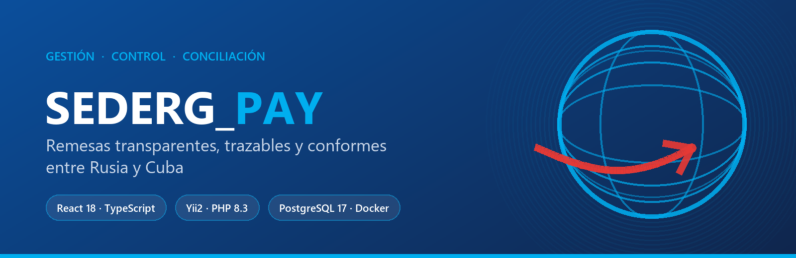
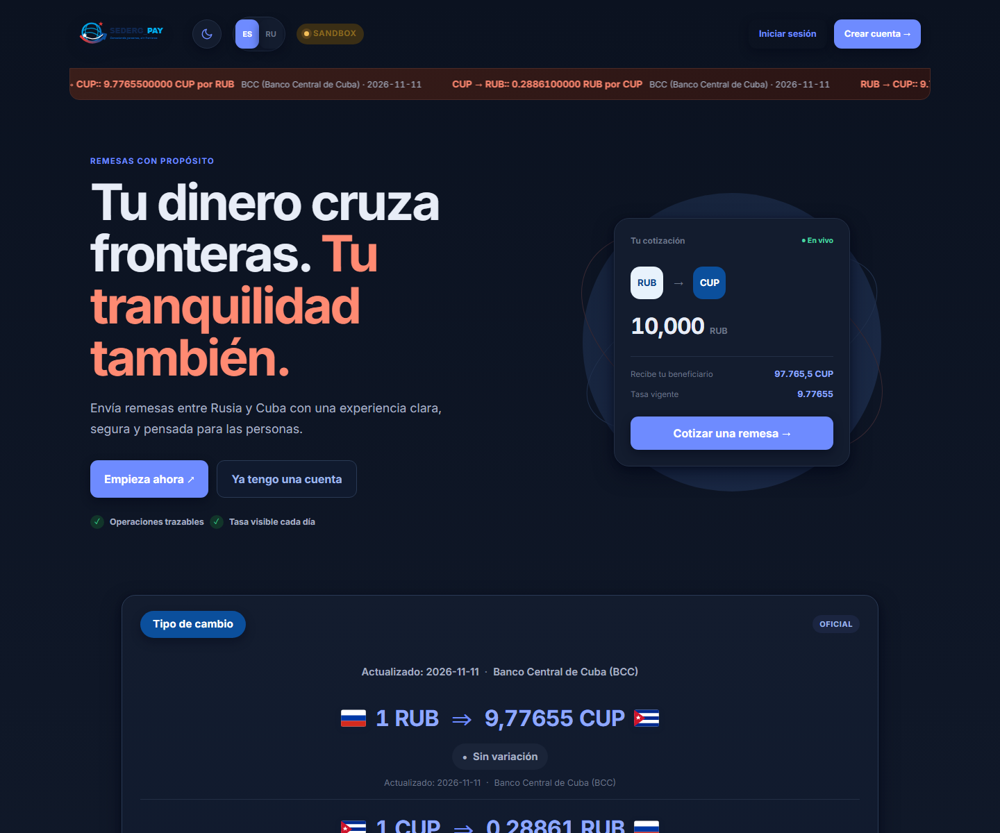
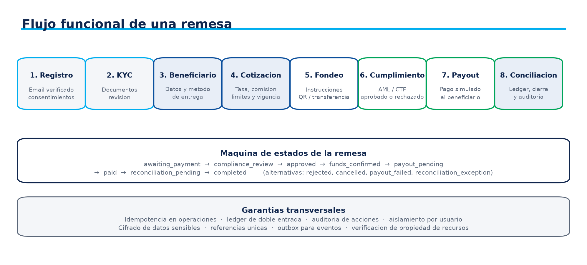
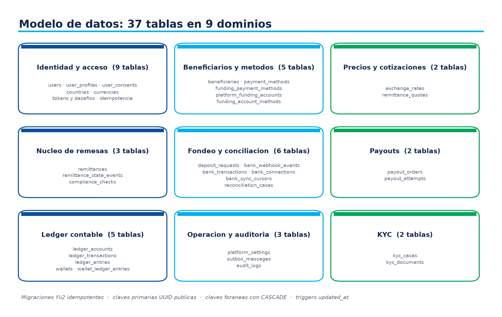
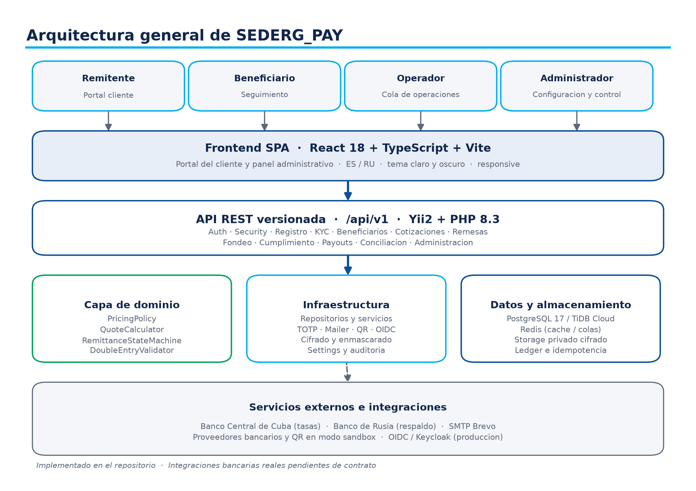

<div align="center">
  
</div>

<div align="center">

# SEDERG_PAY

**Платформа управления, контроля и сверки переводов между Россией и Кубой**

[Демо](https://sedergsoft.github.io/SedergPay_oficial/) · [API](https://5-22-219-30.sslip.io/health) · [Руководство по развёртыванию](./deploy/UPCLOUD.md)

[Español](./README.md) · [Русский](./README.ru.md)

</div>

---

<div align="center">

[](https://github.com/sedergsoft/SedergPay_oficial/actions/workflows/ci.yml)
[](https://github.com/sedergsoft/SedergPay_oficial/actions/workflows/deploy-pages.yml)
[](https://github.com/sedergsoft/SedergPay_oficial/actions/workflows/deploy.yml)

[](https://react.dev/)
[](https://www.typescriptlang.org/)
[](https://www.php.net/)
[](https://www.yiiframework.com/)
[](https://www.postgresql.org/)
[](https://docs.docker.com/)
[](https://caddyserver.com/)

</div>

<div align="center">

🌍 **Приложение:** <https://sedergsoft.github.io/SedergPay_oficial/>
🔌 **Публичный API:** <https://5-22-219-30.sslip.io>
🩺 **Health check:** <https://5-22-219-30.sslip.io/health>
🇷🇺🇨🇺 **Языки:** Español · Русский

</div>

---

## 📸 Скриншоты

<div align="center">
  
</div>

<div align="center">
  <table>
    <tr>
      <td width="50%"></td>
      <td width="50%"></td>
    </tr>
    <tr>
      <td align="center">Полный цикл перевода</td>
      <td align="center">Физическая модель данных</td>
    </tr>
  </table>
</div>

---

## 📖 Содержание

- [Что такое SEDERG_PAY](#-что-такое-sederg_pay)
- [Функциональные модули](#-функциональные-модули)
- [Технологический стек](#-технологический-стек)
- [Архитектура](#-архитектура)
- [Быстрый старт](#-быстрый-старт)
- [Развёртывание в продакшене](#-развёртывание-в-продакшене)
- [REST API](#-rest-api)
- [Безопасность](#-безопасность)
- [Языки](#-языки)
- [Качество и CI](#-качество-и-ci)
- [Структура репозитория](#-структура-репозитория)
- [Документация](#-документация)
- [Дорожная карта](#-дорожная-карта)
- [Участие в проекте](#-участие-в-проекте)
- [Лицензия](#-лицензия)

---

## 💡 Что такое SEDERG_PAY?

SEDERG_PAY — платформа **переводов**, которая объединяет котирование, отправку, комплаенс,
сверку и прослеживаемость переводов между Россией и Кубой.

Проект состоит из трёх частей:

| Часть | Технологии | Назначение |
|---|---|---|
| **Веб-портал** | React 18 + TypeScript + Vite | Котировки, получатели, статусы переводов и панель администратора |
| **REST API** | Yii2 + PHP 8.3 | Бизнес-правила, идемпотентность, KYC, безопасность аккаунта и аудит |
| **Данные** | PostgreSQL 17 | Транзакционная схема, ledger, идемпотентность и журнал аудита |

### ✅ Реализовано

- Котировки по **официальному курсу Банка Кубы** и административному курсу для каждой пары.
- Регистрация с подтверждением почты, версионированным согласием и профилем клиента.
- **MFA (TOTP)** с кодами восстановления, сменой и восстановлением пароля.
- Управление **получателями** и способами выплаты по странам.
- Жизненный цикл перевода: котировка → заказ → депозит → комплаенс → сверка.
- **KYC** с проверкой реальной сигнатуры файла и **антивирусным сканированием ClamAV** (fail-closed).
- Панель администратора: настройки, курсы, пользователи, KYC, метрики и история изменений.
- Ledger с **двойной записью**, идемпотентность по ключу и аудит критичных действий.
- Автоматизированное развёртывание: GitHub Pages (фронтенд) + UpCloud (API, PostgreSQL, ClamAV, Caddy с TLS).

### ⚠️ Честные ограничения текущего состояния

- Банковские интеграции **симулированы** (режим *sandbox*): нет хранения средств и доступа к
  реальным счетам. Требуются договор и учётные данные провайдера.
- Публичное развёртывание использует `SEDERG_AUTH_MODE=development` — это **только демонстрация**.
  Для работы с реальными клиентами нужны OIDC/Keycloak, реальный SMTP и обязательный KYC.
- Ledger — начальная база: до пилота требуется явная двойная запись.
- Договорная и регуляторная часть проверяются внешне.

---

## 🧩 Функциональные модули

| Модуль | Назначение | Статус |
|---|---|---|
| **Котировки** | Сумма к получению, комиссия и лимиты; срок действия 15 минут | ✅ Реализовано |
| **Переводы** | Машина состояний: создан → задепонирован → комплаенс → выплачен/сверен | ✅ Реализовано |
| **Депозиты** | Запрос пополнения со ссылкой, QR и счётом funding | ✅ Sandbox |
| **Выплаты** | Очереди выплат по провайдеру и способу | ✅ Sandbox |
| **Сверка** | Сопоставление депозитов с банковскими операциями и кейсы на разбор | ✅ Sandbox |
| **Комплаенс** | Проверки по переводу, ручная проверка и причины отказа | ✅ Реализовано |
| **KYC** | Кейсы, зашифрованные документы, сканирование ClamAV и решение проверяющего | ✅ Реализовано |
| **Безопасность аккаунта** | 2FA, смена и восстановление пароля, вызовы аутентификации | ✅ Реализовано |
| **Администрирование** | Настройки, курсы, пользователи, панель и история | ✅ Реализовано |
| **Реальные банки** | Подключения банков и вебхуки провайдера | ⏳ Ожидает договора |

---

## 🛠️ Технологический стек

### Backend

| Технология | Версия | Назначение |
|---|---|---|
| PHP | 8.3 | Среда выполнения API |
| Yii2 | 2.0.55 | MVC-фреймворк, миграции и валидация |
| PostgreSQL | 17 | Хранение, триггеры и ограничения |
| PHPUnit | 10.5 | Модульные и интеграционные тесты |
| ClamAV | stable | Антивирусное сканирование вложений KYC |

### Frontend

| Технология | Версия | Назначение |
|---|---|---|
| React | 18.3 | SPA клиента и панель администратора |
| TypeScript | 5.6 | Строгая типизация домена |
| Vite | 5.4 | Сборка и production-бандл |
| Nginx | 1.27 | Статика и прокси `/api` |

### Инфраструктура

| Технология | Назначение |
|---|---|
| Docker Compose | Полный стек (API, PostgreSQL, ClamAV, Caddy, фронтенд) |
| Caddy 2 | Автоматический TLS и обратный прокси |
| UpCloud | Cloud Server для backend |
| GitHub Actions | CI, публикация в Pages и развёртывание по SSH |

---

## 🏗️ Архитектура

<div align="center">
  
</div>

Доменный слой изолирован от инфраструктуры: `PricingPolicy`, `QuoteCalculator`,
`RemittanceStateMachine` и `DoubleEntryValidator` не зависят от фреймворка. Адаптеры
(TOTP, почта, QR, OIDC, шифрование) внедряются, поэтому замена провайдера не затрагивает
бизнес-правила.

---

## 🚀 Быстрый старт

### Вариант 1 — локальный автономный стек (рекомендуется)

```bash
git clone https://github.com/sedergsoft/SedergPay_oficial.git
cd SedergPay_oficial

# 1. Переменные окружения
cp deploy/local/env.local.example .env.local

# 2. Сборка и запуск
docker compose --env-file .env.local -f deploy/local/docker-compose.local.yml up -d --build

# 3. Схема БД (16 миграций)
docker compose --env-file .env.local -f deploy/local/docker-compose.local.yml \
  run --rm backend php yii migrate --interactive=0
```

| Сервис | Локальный URL |
|---|---|
| Фронтенд | <http://localhost:5173> |
| API | <http://localhost:8080> |
| Health | <http://localhost:8080/health> |

> PostgreSQL не публикуется на хост: доступ через
> `docker compose ... exec postgres psql -U sederg_app -d sederg_pay`.
> Письма не отправляются (`SEDERG_MAIL_TRANSPORT=log`): ссылка подтверждения
> попадает в лог backend.

### Вариант 2 — стек разработки (с ClamAV и bind-mounts)

```bash
docker compose up -d --build
docker compose run --rm backend php yii migrate --interactive=0
```

### Вариант 3 — только backend на локальном PHP

```bash
cd backend
composer install
php yii serve 0.0.0.0:8080 --docroot=web
```

---

## ☁️ Развёртывание в продакшене

Backend развёрнут и проверен в UpCloud с автоматическим TLS:

```bash
curl https://5-22-219-30.sslip.io/health
# {"status":"ok","service":"sederg-pay-api","environment":"sandbox"}
```

Полный runbook — сервер, firewall, DNS, секреты, развёртывание, бэкапы, откат и чек-лист
приёмки — в **[`deploy/UPCLOUD.md`](./deploy/UPCLOUD.md)**.

### Автоматизация через GitHub Actions

| Workflow | Назначение |
|---|---|
| [`ci.yml`](./.github/workflows/ci.yml) | Линт PHP, PHPUnit, миграции на PostgreSQL 17, проверка Compose и сборка фронтенда |
| [`deploy-pages.yml`](./.github/workflows/deploy-pages.yml) | Публикация SPA в GitHub Pages с `VITE_API_BASE_URL` |
| [`deploy.yml`](./.github/workflows/deploy.yml) | Развёртывание backend в UpCloud по SSH: инкрементальный `rsync`, миграции, ожидание доступности и **авто-откат** |
| [`migrate-db.yml`](./.github/workflows/migrate-db.yml) | Миграции к управляемой базе данных |

---

## 🔌 REST API

Контракт: [`backend/docs/openapi.yaml`](./backend/docs/openapi.yaml) · 17 маршрутов в `/api/v1`.

| Метод | Маршрут | Назначение |
|---|---|---|
| `GET` | `/health` | Проверка состояния сервиса |
| `POST` | `/api/v1/registrations` | Регистрация клиента с согласием |
| `POST` | `/api/v1/auth/login` | Аутентификация (OIDC в продакшене) |
| `POST` | `/api/v1/auth/verify-email` | Подтверждение почты |
| `GET` | `/api/v1/account/security` | Состояние 2FA и сессии |
| `POST` | `/api/v1/account/security/2fa/setup` | Настройка TOTP |
| `GET` | `/api/v1/funding-methods/{country}` | Способы оплаты по стране |
| `POST` | `/api/v1/beneficiaries` | Добавление получателя |
| `POST` | `/api/v1/quotes` | Котировка с курсом и комиссией |
| `POST` | `/api/v1/remittances` | Создание перевода из котировки |
| `POST` | `/api/v1/remittances/{id}/deposit` | Запрос депозита |
| `POST` | `/api/v1/remittances/{id}/compliance-review` | Проверка комплаенса |
| `POST` | `/api/v1/remittances/{id}/reconcile` | Сверка выплаты |
| `GET/PUT` | `/api/v1/admin/settings` | Операционные настройки |
| `POST` | `/api/v1/admin/exchange-rate` | Административный курс пары |

### Пример

```bash
curl -X POST https://5-22-219-30.sslip.io/api/v1/quotes \
  -H 'Content-Type: application/json' \
  -H 'Idempotency-Key: 3f1c0b7e-4f2a-4a1e-9c33-9f0d1a2b3c4d' \
  -d '{
        "source_country_code": "RU",
        "destination_country_code": "CU",
        "send_amount": "20000",
        "send_currency": "RUB",
        "receive_currency": "CUP",
        "payout_method_code": "cash_pickup"
      }'
```

---

## 🔐 Безопасность

| Механизм | Реализация |
|---|---|
| Аутентификация | OIDC/Keycloak в продакшене · режим `development` в sandbox |
| MFA | TOTP с кодами восстановления и вызовами аутентификации |
| Чувствительные данные | Шифрование вложений KYC и данных аккаунта; ключи вне репозитория |
| Антивирус | ClamAV во внутренней сети; при недоступности загрузка **отклоняется** (fail-closed) |
| Идемпотентность | Обязательна для котировок и переводов; повторы не создают дубликаты |
| Аудит | Журнал критичных действий с актором и корреляцией |
| Ledger | Двойная запись и проверяемые остатки |
| Сеть | PostgreSQL, ClamAV и API **не** опубликованы в интернет; открыты только 80/443 |
| Секреты | Только в переменных окружения (`chmod 600`) и в зашифрованных GitHub Secrets |

---

## 🌍 Языки

Публичный интерфейс и навигация доступны на **русском** и **испанском** языках через
централизованный каталог [`frontend/src/i18n.ts`](./frontend/src/i18n.ts). Предпочтение
сохраняется локально; дизайн адаптивный, со светлой и тёмной темами.

---

## 🧪 Качество и CI

| Элемент | Количество |
|---|---|
| Миграции PostgreSQL | 16 |
| Классы домена | 29 |
| Файлы тестов | 9 |
| Документированные маршруты | 17 |
| CI/CD workflow | 4 |

Каждый `push` в `main` запускает линт PHP, PHPUnit, миграции на PostgreSQL 17, проверку трёх
Compose-файлов и сборку TypeScript.

---

## 📂 Структура репозитория

```text
SEDERG_PAY/
├── backend/            API Yii2: домен, контроллеры, миграции и OpenAPI
│   ├── src/            Бизнес-правила и инфраструктура (29 классов)
│   ├── migrations/     16 миграций PostgreSQL
│   ├── tests/          Модульные и интеграционные тесты
│   └── docs/           openapi.yaml
├── frontend/           SPA React + TypeScript (i18n ES/RU, админ-панель)
├── deploy/             Runbook UpCloud, скрипты и локальный стек с копиями Composer
├── docs/               Диаграммы и генераторы технической памятки
├── scripts/            Утилиты миграции MySQL → PostgreSQL
├── docker-compose.yml              Стек разработки
├── docker-compose.production.yml    Прод-оверлеи (Caddy, ClamAV, без внешних портов)
└── PLAN_DE_ACCION.md   Дорожная карта с фазами, результатами и гейтами
```

---

## 📚 Документация

| Документ | Содержание |
|---|---|
| [`PLAN_DE_ACCION.md`](./PLAN_DE_ACCION.md) | Фазы F0–F6, результаты, гейты и риски |
| [`deploy/UPCLOUD.md`](./deploy/UPCLOUD.md) | Runbook развёртывания, эксплуатация, бэкапы и откат |
| [`backend/docs/openapi.yaml`](./backend/docs/openapi.yaml) | Версионированный контракт REST |
| [`PLAN_DESPLIEGUE_GRATUITO.md`](./PLAN_DESPLIEGUE_GRATUITO.md) | План публикации с минимальными затратами |

---

## 🗺️ Дорожная карта

| Фаза | Статус |
|---|---|
| **F0–F1** Управляемая база (физическая модель, схема, соглашения) | ✅ |
| **F2** Функциональный контракт и OpenAPI | ✅ |
| **F3** Транзакционное ядро (котировки, переводы, идемпотентность) | ✅ |
| **F4** Депозит, ledger и симулированная сверка | ✅ |
| **F5** Рабочий фронтенд в sandbox | ✅ |
| **F6** Контролируемый пилот (OIDC, реальный SMTP, обязательный ClamAV, реальный банк) | ⏳ Внешние гейты |

---

## 🤝 Участие в проекте

1. Создайте ветку от `main`: `git checkout -b feature/my-change`.
2. Соблюдайте стиль окружающего кода и не добавляйте зависимости фреймворка в домен.
3. Прогоните `docker compose --env-file .env -f deploy/local/docker-compose.local.yml run --rm backend vendor/bin/phpunit`
   и `npm run build` в `frontend/`.
4. Откройте *pull request* с описанием изменения и его влияния на контракт REST.

Новые миграции должны быть обратимыми и проходить на PostgreSQL 17.

---

## 📄 Лицензия

**Проприетарная.** Все права защищены SEDERG. Код, документация и визуальные материалы не
распространяются под открытой лицензией. Для оценочного использования свяжитесь с командой
проекта.

---

<div align="center">

**[SEDERG_PAY](https://github.com/sedergsoft/SedergPay_oficial)** ·
*Соединяя людей без границ* 🇷🇺 🇨🇺

</div>
